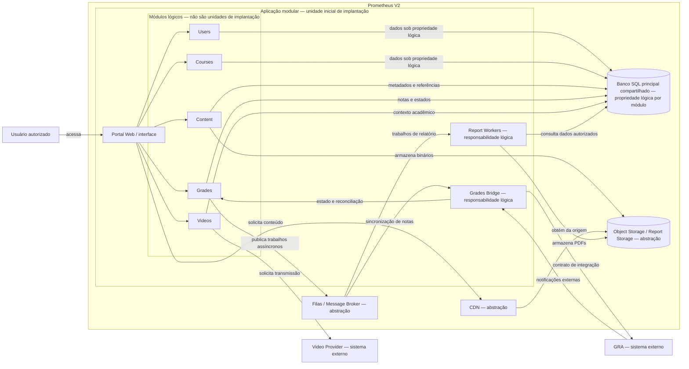

# Nível 2 — Contêineres

> **Estado documental:** visão conceitual vigente na documentação arquitetural, revisada em 19 de agosto de 2026. O diagrama não comprova implementação nem seleciona produto ou fornecedor.

## Escopo e regra de leitura

O Prometheus V2 é delimitado como um sistema. Sua implantação inicial contém uma **aplicação modular implantada como uma unidade**. Users, Courses, Content, Grades e Videos são responsabilidades lógicas internas, não cinco contêineres, processos ou microsserviços.

Grades Bridge e Report Workers também aparecem como responsabilidades dentro da aplicação. As demais caixas representam persistência, capacidades de infraestrutura ou sistemas externos. As setas entre o portal e os módulos representam contratos lógicos; não comprovam comunicação de rede.

## Diagrama

A [fonte editável equivalente em PlantUML](/home/02-Arquitetura/Diagramas-C4/Fonte-PlantUML-Nivel-2-Conteineres) representa os contêineres sem transformar módulos, Grades Bridge ou Report Workers em contêineres próprios. A versão deve ser renderizada e revisada antes de substituir o diagrama exibido acima.

## Legenda e limites

| Elemento | Interpretação |
|---|---|
| Aplicação modular | Contêiner de aplicação e unidade inicial de implantação |
| Users, Courses, Content, Grades e Videos | Módulos lógicos internos |
| Grades Bridge e Report Workers | Responsabilidades lógicas internas; topologia física ainda não definida |
| Banco SQL principal | Persistência inicialmente compartilhada, com propriedade lógica por módulo; SGBD aberto |
| Filas / Message Broker | Abstração de mensageria; produto, quantidade de filas e garantias de entrega em aberto |
| Object Storage / Report Storage e CDN | Abstrações de armazenamento e entrega; fornecedores e políticas em aberto |
| GRA e Video Provider | Sistemas externos; o fornecedor de vídeo permanece aberto |

O agrupamento visual de Object Storage e Report Storage não afirma que conteúdos e relatórios usem o mesmo produto ou as mesmas políticas. O posicionamento das abstrações de infraestrutura no limite da solução indica dependência arquitetural, não propriedade operacional ou contrato já definido.

O desenho não adota cache, persistência própria de Grades, réplicas, redundância ativa/ativa, implantação independente ou plataforma de orquestração. Essas possibilidades continuam evoluções condicionadas a métricas e novas decisões.

## Rastreabilidade

Esta visão representa [DA-02 a DA-09](/home/02-Arquitetura/Decisoes-Arquiteturais). Seus detalhes e limites estão em [Módulos e Responsabilidades](/home/02-Arquitetura/Modulos-e-Responsabilidades), [Dados e Integrações](/home/02-Arquitetura/Dados-e-Integracoes) e [Processamento Assíncrono de Relatórios](/home/02-Arquitetura/Processamento-Assincrono-de-Relatorios).
