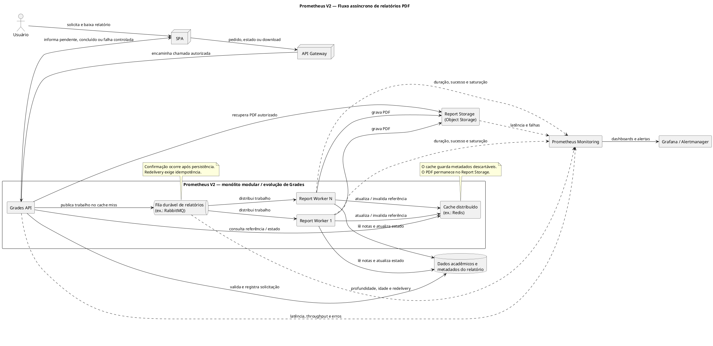

# Plano de Melhoria de Desempenho e Disponibilidade — Relatórios PDF

## 1. Introdução e Funcionalidade Selecionada

A funcionalidade selecionada é a **geração e o download de relatórios acadêmicos em PDF**. Ela é sensível ao desempenho porque combina leitura de notas, agregação de resultados, aplicação de regras, montagem do documento e transferência de um arquivo. Em períodos como fechamento de semestre e publicação de resultados, vários usuários podem solicitar relatórios enquanto professores e estudantes continuam utilizando outras funções do Prometheus.

O [RNF05](../01-Requisitos/Requisitos-Nao-Funcionais.md) determina que a Grades API suporte até 500 relatórios PDF simultâneos sem degradar significativamente a navegação. Esse é o único volume numérico adotado neste plano. Não há informação documentada sobre quantidade total de usuários, throughput esperado ou duração máxima da geração; essas referências deverão ser obtidas por medição.

O objetivo não é apenas produzir PDFs mais rapidamente. A melhoria precisa isolar a carga pesada, reutilizar resultados válidos, limitar concorrência, preservar notas e relatórios, manter o restante do LMS disponível e tornar o fluxo observável.

## 2. Situação Atual no Prometheus V1

O Prometheus V1 é uma aplicação monolítica composta por páginas ASP clássico, lógica concentrada em uma biblioteca C# e um banco MySQL compartilhado. A geração do relatório ocorre de maneira síncrona no mesmo fluxo de requisição que atende a aplicação. O usuário permanece aguardando enquanto o sistema consulta notas, calcula resultados e produz o PDF.

Quando várias solicitações ocorrem simultaneamente, a geração compete com a navegação por CPU, memória, conexões de banco e operações de entrada e saída. Uma tarefa intensiva pode, portanto, elevar também a latência de consultas de cursos, usuários e notas. O banco central participa de diferentes tipos de carga e o backend não consegue escalar seletivamente somente o processamento de documentos.

O material da Semana 5 não comprova que bloqueios de banco sejam a causa específica. A afirmação tecnicamente sustentada é a existência de **contenção em recursos compartilhados**. Antes de otimizar consultas ou trocar a persistência, é necessário medir onde o tempo é consumido e retirar a criação do PDF do caminho síncrono.

Esse comportamento prejudica desempenho e escalabilidade e também afeta disponibilidade percebida: um pico de relatórios pode tornar lenta uma função que não depende de documentos. A ausência de telemetria detalhada ainda aumenta o tempo necessário para localizar saturação, falhas de worker ou crescimento da fila.

## 3. Atributos de Qualidade e Objetivos

| Atributo | Problema observado | Objetivo da proposta | Forma de verificação |
|---|---|---|---|
| Desempenho | Geração síncrona aumenta o tempo de resposta e compete com a navegação | Responder rapidamente ao pedido e processar o PDF fora da requisição | Latência de aceite, tempo na fila, duração do processamento e tempo total até disponibilidade |
| Escalabilidade | Uma única execução concentra o processamento | Distribuir trabalhos entre workers concorrentes e permitir expansão horizontal | Teste com até 500 solicitações simultâneas e navegação concorrente |
| Disponibilidade | Sobrecarga ou falha na geração pode afetar outras funções | Isolar relatórios e degradar apenas essa capacidade | Teste de falha de worker, fila e armazenamento sem indisponibilizar consultas comuns |
| Confiabilidade | Um trabalho pode ser perdido, repetido ou gerar documento antigo | Usar fila durável, confirmação, idempotência, versionamento e invalidação | Comparação do resultado, redelivery controlado e ausência de duplicação visível |
| Observabilidade | O fluxo síncrono não revela claramente espera, saturação ou falha | Instrumentar API, fila, workers, banco, cache e armazenamento | Dashboards, correlação, alertas e diagnóstico de cada etapa |
| Manutenibilidade | Regra de relatório permanece misturada ao atendimento web | Encapsular solicitação, processamento e armazenamento por contratos | Testes independentes e mudança no gerador sem alterar a navegação |

A meta global de disponibilidade do LMS permanece 99,9%, mas não deve ser atribuída isoladamente à fila, ao cache ou aos workers. O plano contribui para a meta ao impedir que uma carga localizada provoque indisponibilidade geral.

## 4. Métricas e Monitoramento

As métricas precisam acompanhar o fluxo completo, e não somente a duração da função que monta o PDF. Percentis como p50, p95 e p99 permitem observar a distribuição da latência sem inventar um limite ainda não aprovado.

| Categoria | Métrica | Justificativa |
|---|---|---|
| Latência | Tempo para validar e aceitar a solicitação | Mede a experiência síncrona antes do processamento assíncrono |
| Latência | Tempo de espera e idade do trabalho mais antigo na fila | Revela backlog mesmo quando a API continua rápida |
| Latência | Duração do processamento no worker | Distingue espera de fila de custo real da geração |
| Latência | Tempo total entre solicitação e relatório disponível | Representa a experiência completa do usuário |
| Latência | Tempo de recuperação e download do PDF | Identifica gargalo no Report Storage ou na entrega |
| Throughput | Solicitações aceitas por unidade de tempo | Mostra a taxa de entrada do sistema |
| Throughput | Relatórios concluídos por unidade de tempo | Permite comparar entrada e capacidade dos workers |
| Throughput | Downloads concluídos por unidade de tempo | Mede a carga de distribuição dos arquivos |
| Erros | Taxa de rejeição da API e falhas de publicação | Identifica perda de capacidade antes da fila |
| Erros | Falhas, retries, redeliveries e mensagens encaminhadas para tratamento manual | Evidencia instabilidade e trabalhos que não terminam |
| Erros | Falhas de leitura, gravação e download no armazenamento | Separa erro de geração de erro na persistência do arquivo |
| Saturação | Profundidade da fila, mensagens não confirmadas e utilização dos workers | Indica quando a demanda supera a capacidade de processamento |
| Saturação | CPU, memória, conexões e tempo de consulta ao banco | Mostra se o paralelismo apenas transferiu o gargalo |
| Cache | Taxa de acerto, erro, invalidação e tempo de resposta | Demonstra se o cache evita processamento sem servir resultado antigo |
| Disponibilidade | Health/readiness dos componentes e sucesso do fluxo | Apoia roteamento, alertas e cálculo do indicador de disponibilidade |

Prometheus Monitoring pode coletar as séries temporais, Grafana pode organizá-las em dashboards e Alertmanager pode notificar a equipe. São ferramentas sugeridas, não produtos já implantados. O nome **Prometheus Monitoring** deve permanecer explícito para não ser confundido com o LMS Prometheus V2.

As métricas precisam compartilhar um identificador de correlação do trabalho, mas identificadores de estudantes, cursos ou relatórios não devem ser usados indiscriminadamente como labels, pois criariam cardinalidade elevada e poderiam expor dados acadêmicos. Logs e trilhas de auditoria podem manter a correlação detalhada sob controles de acesso apropriados.

## 5. Plano de Melhoria

### 5.1 Processamento assíncrono

A Grades API deve validar autorização e parâmetros, identificar se já existe um relatório válido e, quando a geração for necessária, registrar a solicitação e publicar um trabalho em uma fila. A resposta síncrona devolve uma referência para acompanhamento, sem manter a conexão aberta durante a criação do PDF. Uma resposta HTTP `202 Accepted` é uma alternativa de implementação compatível com esse fluxo, não um contrato já aprovado.

Report Workers consomem os trabalhos, consultam os dados necessários, produzem o documento, gravam o arquivo em Report Storage e atualizam o estado da solicitação. A SPA consulta o estado ou recebe uma notificação quando houver mecanismo documentado para isso. O padrão é uma aplicação de *Queue-Based Load Leveling*: a fila absorve variações e separa a taxa de entrada da capacidade de processamento.

Se o registro local da solicitação e a publicação na fila precisarem de consistência atômica, o padrão Transactional Outbox pode ser avaliado. Ele evita confirmar ao usuário um trabalho que nunca foi publicado, mas adiciona persistência e um processo de despacho. Sua adoção depende do desenho definitivo da Grades API e da mensageria.

### 5.2 Cache e reutilização

O plano utiliza **Cache-Aside distribuído** próximo à Grades API. Redis ou uma tecnologia compatível pode armazenar o estado consultado com frequência e a referência de um relatório válido. O PDF não deve ser mantido como grande valor no cache: o arquivo concluído pertence ao Object Storage, enquanto o cache conserva somente metadados pequenos e descartáveis.

A chave lógica precisa considerar o tipo do relatório, o escopo autorizado, o período acadêmico e uma versão dos dados ou da regra de cálculo. Antes de criar um novo trabalho, Grades procura uma referência válida. Em caso de *cache miss*, consulta a fonte de autoridade e, se necessário, publica a geração. A indisponibilidade do cache deve causar perda de desempenho, não perda de dados ou indisponibilidade obrigatória do fluxo.

A expiração combina duas políticas:

- **invalidação orientada a evento:** alteração de nota, republicação de resultado ou mudança da regra de cálculo invalida o relatório correspondente;
- **TTL de segurança:** toda entrada recebe uma expiração configurável para limitar a permanência de referências que não tenham sido invalidadas corretamente.

Não é definido um tempo numérico porque períodos ativos e encerrados possuem ritmos de mudança diferentes. Relatórios de períodos encerrados podem admitir TTL maior; durante lançamento e correção de notas, a política deve usar TTL menor ou consultar diretamente a autoridade quando consistência imediata for necessária.

Para evitar que várias solicitações idênticas criem centenas de trabalhos após um *cache miss*, a API deve usar uma chave idempotente e reutilizar uma solicitação já pendente. Esse mecanismo reduz o efeito de *cache stampede* sem exigir que a geração permaneça dentro da API.

### 5.3 Concorrência e paralelismo

Uma fila como RabbitMQ é um exemplo de implementação do padrão de consumidores concorrentes. Vários Report Workers recebem trabalhos diferentes em paralelo, e novas instâncias podem ser adicionadas quando a profundidade ou a idade da fila indicar saturação. Isso caracteriza escalabilidade horizontal do processamento.

Cada worker precisa impor limite de concorrência. Aumentar threads ou processos sem limite pode esgotar CPU, memória, conexões de banco ou capacidade do Object Storage. Prefetch, tamanho do pool e quantidade de workers devem ser ajustados por teste, utilizando as métricas de fila, banco e tempo de geração.

O consumidor confirma a mensagem somente depois de persistir o PDF e o estado necessário. Se morrer antes da confirmação, o broker pode entregar novamente o trabalho. Como essa entrega tende a ser *at least once*, a geração precisa ser idempotente: a mesma chave de trabalho deve produzir ou reutilizar o mesmo artefato lógico, sem apresentar duplicações ao usuário.

Falhas transitórias podem usar retries limitados com Exponential Backoff. Polly ou `Microsoft.Extensions.Resilience` são alternativas para chamadas compatíveis com .NET, especialmente banco, armazenamento ou serviços externos. Após o limite, o trabalho deve ser preservado para inspeção e reprocessamento controlado, por exemplo em uma Dead Letter Queue, evitando repetição infinita.

### 5.4 Disponibilidade e degradação controlada

Workers redundantes evitam que a falha de uma instância interrompa toda a geração. A fila precisa ser durável, as mensagens importantes devem ser persistidas e a implantação do broker deve possuir a redundância exigida pelo ambiente. RabbitMQ é apenas um exemplo; o produto final continua aberto.

Se todos os workers estiverem indisponíveis, a Grades API e a navegação permanecem operacionais. A SPA apresenta o relatório como pendente ou temporariamente atrasado. Relatórios válidos já armazenados continuam disponíveis para usuários autorizados. O sistema não deve informar que um novo documento foi concluído quando a fila ou o armazenamento não confirmou a operação.

Health checks precisam distinguir processo vivo de instância pronta. Um worker pode estar em execução, mas incapaz de ler o banco ou gravar no Report Storage. Alertas devem considerar idade da fila, ausência de consumo, taxa de falhas, armazenamento indisponível e crescimento de mensagens não confirmadas.

Failover do broker, do banco e do Object Storage depende da tecnologia selecionada e deve ser testado. A arquitetura não deve supor que marcar uma fila como durável garante sozinho recuperação completa. Confirmações do produtor e consumidor, replicação, idempotência e reconciliação participam da confiabilidade do fluxo.

### 5.5 Armazenamento e download

O PDF concluído deve ser armazenado em Object Storage ou Report Storage, fora do banco transacional principal. O banco mantém estado, autoria, parâmetros, versão e referência do objeto. Essa separação evita transformar novamente a persistência acadêmica em servidor de arquivos.

Como relatórios contêm dados acadêmicos sensíveis, o download precisa validar autenticação, autorização e vínculo antes da entrega. Uma CDN privada pode ser avaliada para documentos imutáveis e acessados repetidamente, desde que ofereça expiração e acesso protegido. Ela não deve ser adotada como cache público nem presumida como necessária: primeiro devem ser medidos a latência e o volume de download do Report Storage.

## 6. Ferramentas e Padrões Aplicáveis

| Necessidade | Ferramenta ou padrão real | Uso proposto | Estado da decisão |
|---|---|---|---|
| Desacoplar e nivelar a carga | Queue-Based Load Leveling | Separar entrada de solicitações e capacidade dos workers | Padrão arquitetural adotado |
| Implementar a fila | RabbitMQ ou broker equivalente | Fila durável, acknowledgements, consumidores concorrentes e tratamento de falhas | Exemplo; produto não selecionado |
| Cache distribuído | Cache-Aside com Redis ou equivalente | Estado e referências reutilizáveis com TTL e invalidação | Exemplo; produto não selecionado |
| Armazenar PDFs | Object Storage | Persistir documentos fora do banco principal | Capacidade arquitetural adotada; fornecedor aberto |
| Resiliência de chamadas | Polly ou `Microsoft.Extensions.Resilience` | Timeout, retry limitado e backoff para falhas transitórias | Exemplo de implementação .NET |
| Métricas e alertas | Prometheus Monitoring + Grafana + Alertmanager | Coletar séries, visualizar fluxo e alertar sobre saturação ou falha | Ferramentas avaliadas; não implantadas |
| Distribuição opcional | CDN privada | Reduzir latência de downloads autorizados quando medições justificarem | Alternativa condicionada a segurança e carga |

Ferramentas não substituem requisitos. Redis sem invalidação pode servir referência antiga; RabbitMQ sem confirmação pode perder ou repetir trabalho; Prometheus Monitoring sem métricas adequadas não revela o gargalo. A decisão deve partir do comportamento necessário e permanecer substituível.

## 7. Arquitetura Funcional Proposta

O fluxo separa o atendimento web do processamento intensivo. A Grades API continua responsável pela autorização e pela regra que decide criar ou reutilizar um relatório. A fila e os workers ficam dentro da arquitetura modular enquanto não existir evidência para uma implantação independente; caixas separadas representam responsabilidades, não microsserviços obrigatórios.

O cache acelera consultas de estado e reutilização, mas não é fonte de autoridade. Os dados acadêmicos e metadados persistentes permitem reconstruir o estado se o cache falhar. O Report Storage conserva o arquivo, e a entrega continua controlada por Grades. Todos os componentes relevantes publicam métricas para uma visão operacional comum.

## 8. Plano de Validação

Primeiro deve ser medida uma linha de base do V1: tempo de geração, latência da navegação durante o processamento, consumo de CPU e memória, conexões e erros. Sem essa referência, não é possível demonstrar a melhoria.

No V2, os testes devem incluir:

1. navegação sem geração de relatórios, para estabelecer a latência normal;
2. solicitação com cache frio e com resultado reutilizável;
3. até 500 solicitações simultâneas de PDF acompanhadas de navegação concorrente;
4. alteração de nota e verificação da invalidação do relatório afetado;
5. encerramento de um worker antes da confirmação, verificando redelivery sem duplicação visível;
6. indisponibilidade temporária do cache, broker e Report Storage;
7. recuperação da infraestrutura e conclusão ou reconciliação dos trabalhos pendentes.

O RNF05 é aceito quando a carga documentada é concluída sem degradação significativa da navegação conforme um limite previamente acordado. O cenário precisa registrar percentis, throughput, erros, fila e utilização dos recursos. A simples existência de vários workers não comprova escalabilidade.

## 9. Trade-offs

O processamento assíncrono protege a navegação, mas o relatório deixa de ser entregue imediatamente. A interface precisa mostrar estado e conclusão de maneira compreensível. A fila adiciona broker, persistência, política de retry e tratamento de mensagens problemáticas.

Cache reduz trabalho repetido, porém exige versionamento e invalidação. TTL muito longo amplia o risco de referência desatualizada; TTL muito curto reduz a taxa de acerto. Invalidação por evento melhora a precisão, mas cria mais pontos de integração.

Paralelismo aumenta throughput até alcançar outro limite. Workers demais podem saturar banco e armazenamento, por isso escala deve responder a métricas e respeitar limites de concorrência. Redundância melhora disponibilidade, mas aumenta custo, operação e quantidade de cenários de falha.

Object Storage retira os PDFs do banco, mas exige conciliar metadado e objeto. A CDN pode acelerar o download, porém relatórios acadêmicos demandam controle de acesso e expiração rigorosos. Observabilidade amplia a capacidade de diagnóstico, mas labels e logs precisam evitar alta cardinalidade e exposição de informações sensíveis.

## 10. Conclusão

O gargalo dos relatórios PDF no Prometheus V1 decorre do processamento síncrono e da competição com a navegação por recursos compartilhados. O plano propõe uma resposta coerente com os atributos da Semana 5: Cache-Aside e pré-computação evitam trabalho repetido; fila e workers isolam e paralelizam a geração; Object Storage separa os arquivos da persistência acadêmica; health checks, redundância, degradação controlada e monitoramento sustentam disponibilidade.

A solução preserva o monólito modular como estilo inicial e introduz componentes especializados somente onde o comportamento exige. RabbitMQ, Redis, Polly, Prometheus Monitoring, Grafana, Alertmanager e CDN são exemplos reais, não decisões fechadas. A adoção deve ser guiada pela linha de base e pelos testes do RNF05, mantendo confiabilidade, segurança e capacidade de recuperação tão importantes quanto velocidade.

## Referências

- AMAZON WEB SERVICES. [What is Amazon S3?](https://docs.aws.amazon.com/AmazonS3/latest/userguide/Welcome.html). Amazon Simple Storage Service. Acesso em: 16 ago. 2026.
- GRAFANA LABS. [Dashboards](https://grafana.com/docs/grafana/latest/visualizations/dashboards/). Grafana Documentation. Acesso em: 16 ago. 2026.
- JALA UNIVERSITY. *Arquitetura de Software II — Projeto Capstone Prometheus V1/V2*. Material didático da disciplina, 2026.
- MICROSOFT. [Queue-Based Load Leveling pattern](https://learn.microsoft.com/en-us/azure/architecture/patterns/queue-based-load-leveling). Azure Architecture Center. Acesso em: 16 ago. 2026.
- PLANTUML. [Deployment Diagram syntax and features](https://plantuml.com/deployment-diagram). Acesso em: 16 ago. 2026.
- PROMETHEUS AUTHORS. [Overview](https://prometheus.io/docs/introduction/overview/). Prometheus Documentation. Acesso em: 16 ago. 2026.
- RABBITMQ. [Reliability Guide](https://www.rabbitmq.com/docs/reliability). Acesso em: 16 ago. 2026.
- REDIS. [Keys and values: key expiration](https://redis.io/docs/latest/develop/use/keyspace/). Redis Documentation. Acesso em: 16 ago. 2026.
