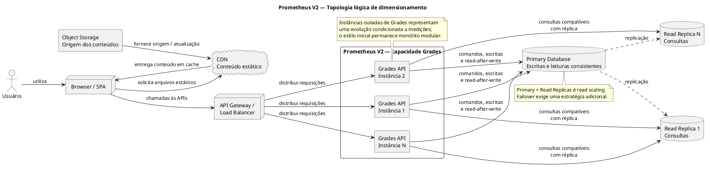

# Estratégias de Dimensionamento para o Prometheus V2

## 1. Introdução

Escalabilidade é a capacidade de sustentar o crescimento da carga sem que o tempo de resposta, a disponibilidade ou a correção das operações se degradem além dos limites aceitos. Esse atributo é relevante para o Prometheus V2 porque o sistema deverá atender acessos externos e períodos acadêmicos com concentração de uso, preservando ao mesmo tempo as informações acumuladas pelo Prometheus V1.

A Grades API é uma das capacidades mais sensíveis a esse crescimento. No fechamento de semestre, professores publicam ou corrigem notas enquanto estudantes e responsáveis consultam resultados. A geração de relatórios adiciona processamento intensivo, embora os [Requisitos Não Funcionais](../01-Requisitos/Requisitos-Nao-Funcionais.md) já determinem que os PDFs sejam retirados do fluxo síncrono e enviados para fila e Report Workers. O dimensionamento da API interativa e da persistência complementa esse isolamento; não o substitui.

Escalar não significa apenas aumentar CPU ou memória de uma máquina. O dimensionamento vertical pode oferecer ganho inicial, mas permanece limitado à capacidade de um único nó. O dimensionamento horizontal distribui o trabalho entre instâncias e, na camada de dados, pode separar a carga de comandos da carga predominante de consultas. A combinação precisa preservar consistência, observabilidade e capacidade de operação.

Esta atividade descreve uma topologia-alvo, ainda sujeita a validação. Conforme a [Visão Geral da Arquitetura](Visao-Geral.md), o Prometheus V2 permanece um **monólito modular**, inicialmente com uma unidade de implantação. Users, Courses, Content, Grades e Videos são limites lógicos e contratos de API, não microsserviços obrigatórios. Executar somente Grades em múltiplas instâncias pressupõe que medições justifiquem sua especialização e implantação independente; antes disso, a redundância pode exigir a replicação da aplicação como um todo.

## 2. Contexto da Grades API

Grades concentra avaliações, lançamento e consulta de notas, cálculo acadêmico, publicação de resultados, histórico e relatórios. Essas operações possuem perfis diferentes. O lançamento ou a atualização de uma nota modifica dados críticos e precisa validar professor, turma, matrícula, período e regras de cálculo. A consulta é predominantemente de leitura e pode crescer rapidamente quando resultados são publicados para uma turma ou para toda a instituição.

Em determinados períodos, portanto, o número de leituras tende a ser significativamente maior que o de escritas. Estudantes consultam suas notas, responsáveis acessam os resultados permitidos e professores acompanham turmas. A baixa latência é importante, mas não pode ser obtida devolvendo um valor acadêmico incorreto ou antigo em um fluxo que exija confirmação imediata.

Uma única instância da Grades API pode concentrar conexões, processamento e requisições concorrentes. Mesmo que a API seja replicada, o banco primário ainda pode se tornar o gargalo se todas as consultas e comandos permanecerem direcionados ao mesmo nó. A estratégia precisa, por isso, observar separadamente a camada de aplicação e a camada de persistência.

O material não informa quantidade de usuários, requisições por segundo ou proporção exata entre leituras e escritas. Esses valores deverão ser obtidos por telemetria e testes de carga. O único volume numérico já estabelecido é o RNF05: até 500 relatórios PDF simultâneos sem degradação significativa da navegação. Esse requisito deve ser validado com fila e workers, enquanto a topologia deste documento trata da capacidade interativa de Grades e das consultas aos dados.

## 3. Estratégias de Dimensionamento

### Estratégia 1 — Escalabilidade horizontal da Grades API

**Tipo:** escalabilidade horizontal da camada de aplicação.

**Aplicação:** Grades API, em um cenário no qual o módulo esteja preparado para múltiplas instâncias.

A estratégia posiciona duas ou mais instâncias equivalentes atrás do API Gateway ou de um Load Balancer. O ponto de entrada distribui as requisições somente entre instâncias saudáveis e pode ampliar ou reduzir o conjunto conforme a demanda e a capacidade disponível. Uma falha isolada deixa de interromper necessariamente toda a API, desde que o balanceador e as demais dependências também possuam disponibilidade compatível.

Para que qualquer instância possa atender uma requisição, Grades deve evitar estado de sessão mantido exclusivamente na memória local. Autenticação, correlação e contexto da operação precisam ser transportados ou recuperados por mecanismos compartilhados definidos pela arquitetura. Isso não obriga o uso de JWT, Redis ou outro produto específico; a decisão tecnológica continua aberta.

O benefício direto é distribuir o atendimento simultâneo, reduzir a dependência de uma única instância e permitir expansão incremental da capacidade. O custo aparece na operação: balanceamento, health checks, implantação coordenada, compatibilidade de versões, centralização de logs e métricas, rastreamento de requisições e controle de conexões com o banco. A camada de balanceamento também não pode se tornar um novo ponto único de falha.

### Estratégia 2 — Separação da carga de leitura e gravação no banco

**Tipo:** escalabilidade horizontal da camada de dados, também denominada *read scaling*.

**Aplicação:** persistência consumida por Grades, caso a evolução para uma topologia replicada seja aprovada.

O banco primário recebe todos os comandos de criação e alteração. Lançamento de nota, correção, publicação e mudanças que preservam invariantes acadêmicas são confirmados no primário. Uma ou mais réplicas recebem os dados por replicação e atendem consultas compatíveis com possível atraso, reduzindo o volume de leitura processado pelo nó principal.

Essa divisão é adequada quando consultas de notas publicadas são mais frequentes que gravações. Novas réplicas podem ampliar a capacidade de leitura, e a política de acesso pode distribuí-las entre as instâncias da Grades API. Entretanto, réplica de leitura não constitui escalabilidade vertical: ela adiciona nós à persistência e, portanto, é uma forma de dimensionamento horizontal.

O principal risco é o *replication lag*. Uma consulta enviada a uma réplica logo após a atualização pode retornar a versão anterior. Fluxos que exigem consistência forte — por exemplo, confirmar ao professor o valor recém-gravado ou validar uma operação dependente dessa escrita — devem consultar o primário ou utilizar uma estratégia explícita de *read-after-write*. Consultas tolerantes a pequeno atraso podem usar as réplicas. O roteamento deve ser determinado pela semântica da operação, e não apenas pelo verbo HTTP.

Primary + Read Replicas também não deve ser confundido com a proposta *primary/standby* estudada para failover. Réplicas de leitura aumentam a capacidade de consulta, mas não se tornam automaticamente candidatas seguras à promoção. Alta disponibilidade do banco exige decisões adicionais sobre replicação, promoção, RPO, RTO e reconexão. Além disso, o SGBD do V2 e a persistência especializada de Grades ainda não foram escolhidos.

| Estratégia | Tipo de estratégia | A que se aplica | Benefícios esperados | Riscos associados |
|---|---|---|---|---|
| Múltiplas instâncias da Grades API | Horizontal — camada de aplicação | Processamento de requisições da Grades API | Distribuição do atendimento, expansão incremental, menor dependência de uma instância e melhoria potencial de disponibilidade | Maior custo e complexidade; necessidade de baixo estado local; balanceamento, health checks e observabilidade distribuída |
| Primary + Read Replicas | Horizontal — camada de dados (*read scaling*) | Leituras e escritas da persistência de Grades | Redução da carga de consulta no primário, mais leituras simultâneas e expansão pela adição de réplicas | *Replication lag*, leituras eventualmente desatualizadas, roteamento mais complexo e necessidade de leitura no primário quando houver consistência forte |

### CDN para conteúdo estático

A CDN participa da topologia geral do Prometheus V2, mas não substitui as duas estratégias de Grades. Ela distribui apresentações, documentos, imagens e outros arquivos apropriados para cache, enquanto o Object Storage mantém a origem persistente. Essa separação reduz o tráfego no backend e aproxima o conteúdo dos usuários externos.

As políticas de cache precisam considerar autorização, expiração e invalidação. Quando um arquivo é alterado ou removido, cópias antigas não devem permanecer disponíveis além da política definida. O risco é especificamente servir conteúdo estático desatualizado ou manter um ativo além de sua validade, não uma classificação genérica de consistência eventual dos dados acadêmicos.

## 4. Arquitetura Lógica Escalável

O Browser ou a SPA utiliza dois caminhos. Arquivos estáticos adequados são obtidos pela CDN, cuja origem é o Object Storage. Operações acadêmicas seguem para o API Gateway ou Load Balancer, que distribui as chamadas entre as instâncias saudáveis da Grades API.

Cada instância envia comandos e leituras que exigem confirmação imediata ao banco primário. Consultas que aceitam o atraso definido pela política podem seguir para uma réplica. As ligações de leitura do diagrama são representativas: todas as instâncias devem aplicar a mesma regra de roteamento e podem utilizar as réplicas disponíveis. O primário continua sendo a autoridade para escritas.

A topologia não seleciona Kubernetes, produto de Load Balancer, SGBD ou tecnologia de replicação. Esses elementos são alternativas de implementação a serem avaliadas depois de medições, critérios de consistência e requisitos operacionais.

## 5. Trade-offs da Solução

O ganho de escalabilidade vem acompanhado de infraestrutura adicional. Manter várias instâncias exige capacidade computacional, automação de implantação, health checks e um balanceador altamente disponível. O custo não é apenas financeiro: a equipe precisa observar uma requisição que pode atravessar instâncias distintas e correlacionar logs, métricas e erros.

O baixo estado local facilita o balanceamento, mas obriga a revisar qualquer dependência de sessão em memória herdada do V1. Conexões com o banco também precisam ser dimensionadas, pois adicionar instâncias da API sem controlar seus pools pode apenas transferir o gargalo para a persistência.

As réplicas ampliam a leitura, mas introduzem replicação e decisões de consistência. Encaminhar toda consulta para uma réplica reduz carga no primário, porém pode quebrar fluxos de confirmação imediata. Encaminhar toda leitura para o primário elimina esse risco, mas perde o benefício de *read scaling*. A política deve classificar as consultas pelo requisito de consistência, medir o atraso e permitir retorno ao primário quando necessário.

A CDN reduz latência e tráfego central, mas depende de políticas corretas de expiração e invalidação. Em todas as camadas, mais capacidade não elimina a necessidade de testes: distribuição de requisições, saturação, atraso de replicação, falha de instância e comportamento durante picos precisam ser observados conjuntamente.

## 6. Conclusão

O dimensionamento horizontal da Grades API distribui o atendimento e reduz a dependência de uma única instância. Primary + Read Replicas amplia a capacidade de consultas ao separar parte da carga de leitura do processamento de escritas. A CDN complementa a topologia retirando conteúdo estático do caminho das APIs.

Essas estratégias se relacionam diretamente aos requisitos de desempenho, escalabilidade e disponibilidade do Prometheus V2, mas não constituem uma implantação já aprovada. Sua adoção depende de medições que demonstrem o gargalo, da preparação de Grades para baixo estado local e de uma política explícita de consistência. A geração de até 500 PDFs continua tratada por fila e Report Workers; a nova topologia amplia a capacidade interativa sem substituir esse mecanismo.

## Referências

- AMAZON WEB SERVICES. [How CloudFront delivers content](https://docs.aws.amazon.com/AmazonCloudFront/latest/DeveloperGuide/HowCloudFrontWorks.html). Amazon CloudFront. Acesso em: 16 ago. 2026.
- BASS, Len; CLEMENTS, Paul; KAZMAN, Rick. *Software Architecture in Practice*. 4. ed. Boston: Addison-Wesley, 2021.
- JALA UNIVERSITY. *Arquitetura de Software II — Projeto Capstone Prometheus V1/V2*. Material didático da disciplina, 2026.
- MICROSOFT. [Load balancing options](https://learn.microsoft.com/en-us/azure/architecture/guide/technology-choices/load-balancing-overview). Azure Architecture Center. Acesso em: 16 ago. 2026.
- PLANTUML. [Deployment Diagram syntax and features](https://plantuml.com/deployment-diagram). Acesso em: 16 ago. 2026.
- RICHARDS, Mark; FORD, Neal. *Fundamentals of Software Architecture: An Engineering Approach*. Sebastopol: O'Reilly Media, 2020.
