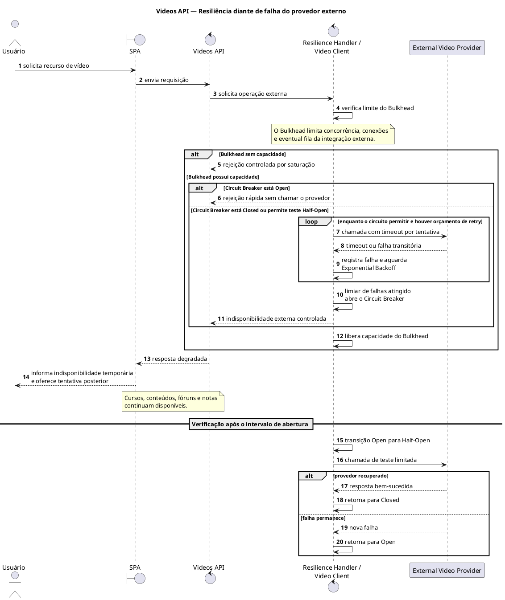

# Padrões de Resiliência e Tolerância a Falhas no Prometheus V2

## 1. Introdução

Sistemas que realizam chamadas de rede precisam assumir que dependências externas apresentarão falhas, lentidão ou indisponibilidade. Resiliência não elimina esses eventos; ela limita sua propagação, oferece respostas controladas e permite que a aplicação se recupere quando a dependência voltar a funcionar.

No Prometheus V2, a Videos API administra o contexto acadêmico das videoconferências — agendamento, autorização, links e gravações — enquanto a transmissão é delegada a um provedor externo. A [Visão Geral da Arquitetura](Visao-Geral.md) estabelece que essa dependência não deve comprometer o restante do LMS. A especialização reduz a necessidade de construir infraestrutura própria de áudio e vídeo, mas cria uma dependência que o Prometheus não controla. A falha do fornecedor deve afetar somente as operações de vídeo que dependem dele, mantendo disponíveis cursos, conteúdos, fóruns, notas e demais funções independentes.

Este documento aplica Retry com Exponential Backoff, Circuit Breaker, Bulkhead e Graceful Degradation ao cliente HTTP utilizado pela Videos API. Os padrões descrevem comportamento arquitetural. Polly e `Microsoft.Extensions.Http.Resilience` aparecem como ferramentas possíveis para uma implementação .NET, não como decisões obrigatórias do projeto.

## 2. Cenário de Falha

O fluxo normal começa quando o usuário solicita na SPA uma operação de vídeo. A SPA chama a Videos API, que valida o contexto acadêmico e utiliza um cliente do provedor para realizar a chamada externa. O fluxo pode ser representado da seguinte forma:

`Usuário → SPA → Videos API → Video Client → External Video Provider`

A dependência pode ultrapassar o timeout, ficar indisponível, responder com erro HTTP, sofrer uma interrupção temporária de rede ou apresentar latência elevada. Esses eventos possuem naturezas diferentes. Uma perda momentânea de conectividade pode desaparecer em uma nova tentativa; uma requisição inválida ou uma autorização negada tende a continuar falhando e não deve ser repetida automaticamente.

Tentativas ilimitadas são perigosas porque prolongam a espera do usuário, ocupam conexões e tarefas da Videos API e aumentam a carga sobre um fornecedor que talvez esteja tentando se recuperar. Quando vários usuários repetem chamadas ao mesmo tempo, o comportamento pode produzir uma *retry storm* e ampliar a indisponibilidade. Por isso, cada tentativa precisa de timeout, o conjunto precisa de limite total e somente falhas classificadas como transitórias podem ser repetidas.

Operações com efeito colateral exigem atenção adicional. Repetir automaticamente a criação de uma sala pode gerar duplicação se o provedor processou a primeira chamada, mas a resposta se perdeu. A repetição só é segura quando a operação é idempotente, utiliza uma chave de idempotência aceita pelo fornecedor ou permite consultar o resultado antes de executar novamente.

## 3. Padrões de Resiliência

### 3.1 Retry com Exponential Backoff

Retry permite repetir uma operação quando a falha possui possibilidade real de ser transitória. A política deve definir quais exceções e respostas são elegíveis, quantas tentativas são permitidas e qual é o tempo máximo da operação. Erros permanentes, como requisição malformada ou acesso negado, devem retornar imediatamente para tratamento da Videos API.

No Exponential Backoff, o intervalo cresce a cada falha. Conceitualmente, o cliente realiza a primeira tentativa; se ela falhar de forma transitória, aguarda um intervalo curto; após nova falha, espera um intervalo maior antes da tentativa seguinte. O processo termina quando uma chamada funciona, o limite é atingido, o timeout total expira ou o Circuit Breaker deixa de permitir chamadas.

Uma pequena variação aleatória, ou *jitter*, pode evitar que muitas instâncias repitam a chamada exatamente no mesmo instante. Os valores de intervalo, timeout e número de tentativas não são definidos neste documento porque precisam refletir o contrato do provedor e ser calibrados com telemetria. O ponto obrigatório é que o conjunto seja limitado e não repita indiscriminadamente operações não idempotentes.

### 3.2 Circuit Breaker

Circuit Breaker impede que a Videos API continue chamando uma dependência que apresenta falhas recorrentes. O circuito mantém três estados:

- **Closed:** chamadas são permitidas e seus resultados alimentam as métricas de falha;
- **Open:** novas chamadas são rejeitadas rapidamente, sem atingir o provedor;
- **Half-Open:** depois de um intervalo, um conjunto limitado de chamadas de teste verifica se a dependência se recuperou.

Quando o limiar configurado é atingido, o circuito passa de Closed para Open. A rejeição rápida reduz timeouts, libera recursos e oferece tempo para o fornecedor se recuperar. Após o intervalo de abertura, o estado Half-Open permite uma sondagem controlada. Resultados suficientes de sucesso fecham o circuito; uma nova falha relevante volta a abri-lo.

Retry e Circuit Breaker cumprem funções diferentes. Retry tenta superar falhas transitórias; Circuit Breaker interrompe chamadas cuja probabilidade de falha se tornou alta. A ordem da composição influencia quais tentativas são contabilizadas pelo circuito, portanto limites, janela de amostragem e orçamento de retries precisam ser definidos como uma única política e validados em conjunto.

### 3.3 Bulkhead

Bulkhead isola os recursos utilizados pela integração de vídeo. A Videos API pode reservar para o cliente externo limites próprios de concorrência, um pool de conexões e, se necessário, uma fila curta e limitada. Quando essa capacidade é consumida, novas chamadas são recusadas ou degradadas rapidamente em vez de ocupar todos os recursos do processo.

O objetivo não é tornar o provedor disponível, mas impedir que sua lentidão esgote conexões, memória ou tarefas que também atendem outras operações da Videos API. O mesmo princípio evita que a integração externa provoque uma falha em cascata no restante do Prometheus. Os limites devem ser observáveis e compatíveis com a capacidade real do fornecedor; uma fila sem limite apenas deslocaria o problema para a memória e aumentaria a latência.

### 3.4 Graceful Degradation

Graceful Degradation mantém a experiência útil mesmo quando a capacidade completa não pode ser entregue. Se o provedor estiver indisponível, a Videos API retorna uma resposta controlada e a SPA informa que o serviço de vídeo está temporariamente indisponível. O usuário pode continuar acessando notas, cursos, conteúdos e fóruns e tentar a operação de vídeo posteriormente.

Sessões previamente cadastradas podem continuar visíveis quando os dados necessários estiverem armazenados localmente e sua apresentação for segura. Um cache também poderia apoiar determinados casos de leitura, mas sua existência não está definida na arquitetura e não deve ser presumida. O fallback nunca deve inventar um link, confirmar uma sala não criada ou exibir informação possivelmente incorreta como se estivesse atualizada.

## 4. Tabela dos Padrões

| Padrão aplicado | Componente | Objetivo | Ferramenta sugerida (opcional) |
|---|---|---|---|
| Retry + Exponential Backoff | Videos API Client | Repetir falhas transitórias de maneira limitada e espaçada | Polly ou `Microsoft.Extensions.Http.Resilience` |
| Circuit Breaker | Videos API Client | Interromper temporariamente chamadas a um provedor com falhas recorrentes | Polly ou `Microsoft.Extensions.Http.Resilience` |
| Bulkhead | Videos API / External Video Client | Isolar os recursos da integração e impedir propagação da falha | Limites de concorrência, Rate Limiting ou mecanismos de resiliência compatíveis com .NET |
| Graceful Degradation | SPA + Videos API | Manter o restante do sistema utilizável e fornecer fallback compreensível | Tratamento de erro na API e estado alternativo no frontend |

As sugestões da última coluna não alteram os pontos ainda abertos da arquitetura. A mesma solução pode ser implementada por biblioteca, recursos da plataforma ou código de infraestrutura, desde que preserve os comportamentos e a observabilidade exigidos.

## 5. Diagrama de Sequência

O diagrama apresenta o caso de falha persistente. Se uma tentativa funcionar antes do limite, o cliente devolve o resultado normalmente e o circuito registra o sucesso. O loop não significa repetição infinita: ele termina pelo orçamento de retry, pelo timeout total ou pela mudança do circuito. A chamada em Half-Open é separada porque ocorre depois do intervalo de abertura, possivelmente durante uma solicitação posterior.

Bulkhead atua durante todo o fluxo. Antes de ocupar recursos para a dependência, o handler verifica a capacidade reservada; ao terminar, libera essa capacidade. Uma saturação local pode produzir a mesma resposta degradada sem enviar carga adicional ao provedor.

## 6. Comportamento em Caso de Falha

Quando chega uma requisição, a Videos API primeiro executa suas validações locais e chama o Video Client. O Bulkhead verifica se há capacidade para a integração. Com capacidade disponível, o Circuit Breaker decide se uma chamada externa é permitida. Se estiver Open, a operação é rejeitada rapidamente. Se estiver Closed — ou se uma sondagem Half-Open for autorizada — o cliente realiza uma tentativa com timeout limitado.

Uma falha classificada como transitória pode ser repetida dentro do orçamento configurado. Entre as tentativas, o Exponential Backoff aumenta o intervalo e pode aplicar *jitter*. Falhas permanentes, ausência de idempotência ou esgotamento do tempo total encerram o processo sem novas chamadas. Resultados sucessivos alimentam o Circuit Breaker; ao atingir o limiar, ele abre e as solicitações seguintes deixam de alcançar imediatamente o provedor.

A Videos API converte a falha técnica em um resultado controlado, e a SPA apresenta uma mensagem compreensível. O restante do Prometheus continua utilizável. Depois do intervalo configurado, o circuito permite testes limitados em Half-Open. Se o fornecedor responder conforme o critério de recuperação, o circuito volta a Closed; se a falha continuar, retorna a Open.

O Bulkhead funciona paralelamente a Retry e Circuit Breaker. Ele controla quantas operações podem ocupar recursos da integração, inclusive durante lentidão e backoff. Métricas devem distinguir rejeição por Bulkhead, circuito aberto, timeout, retry realizado e falha final, permitindo ajustar a política sem esconder indisponibilidades reais.

## 7. Trade-offs

Retry pode recuperar falhas curtas, mas uma política agressiva gera tráfego adicional e pode impedir a recuperação do provedor. Timeout excessivo prende recursos; timeout curto demais transforma respostas válidas em falhas. Também é necessário coordenar retries existentes na SPA, na Videos API, em bibliotecas e no fornecedor para evitar multiplicação de tentativas.

Circuit Breaker reduz espera e chamadas inúteis, mas depende de calibração. Um limiar muito agressivo abre o circuito durante oscilações pequenas e bloqueia um serviço disponível. Uma configuração permissiva demora a interromper falhas persistentes. Half-Open precisa limitar testes para não produzir uma nova sobrecarga no momento da recuperação.

Bulkhead contém a falha, porém reserva e limita recursos. Um limite baixo pode rejeitar demanda que o provedor suportaria; um limite alto reduz o isolamento. Filas aumentam a capacidade de absorver variações curtas, mas precisam ser limitadas para não transformar saturação em espera crescente.

Graceful Degradation melhora a disponibilidade percebida, mas o fallback deve ser honesto. Dados locais ou em cache só podem ser apresentados quando sua origem, validade e autorização forem conhecidas. A interface não deve ocultar uma falha nem indicar sucesso para uma operação que não foi confirmada.

Os quatro padrões aumentam regras, estados, telemetria e testes. A equipe precisa exercitar falha de rede, timeout, respostas permanentes e transitórias, circuito Open/Half-Open, saturação do Bulkhead e recuperação do provedor. A complexidade é aceita para impedir que uma dependência externa comprometa o LMS inteiro.

## 8. Conclusão

Retry com Exponential Backoff oferece recuperação limitada para falhas transitórias. Circuit Breaker interrompe chamadas quando a dependência permanece instável. Bulkhead restringe os recursos que a integração pode consumir, e Graceful Degradation mantém o restante do Prometheus disponível com uma resposta clara ao usuário.

A combinação reduz a propagação de falhas e melhora a disponibilidade percebida da Videos API sem prometer disponibilidade do fornecedor. Seu resultado depende de timeouts, idempotência, limites e métricas adequadamente configurados. As ferramentas continuam substituíveis; o compromisso arquitetural é isolar a dependência, falhar de forma controlada e permitir recuperação observável.

## Referências

- JALA UNIVERSITY. *Arquitetura de Software II — Projeto Capstone Prometheus V1/V2*. Material didático da disciplina, 2026.
- MICROSOFT. [Best practices for transient fault handling](https://learn.microsoft.com/en-us/azure/architecture/best-practices/transient-faults). Azure Architecture Center. Acesso em: 16 ago. 2026.
- MICROSOFT. [Bulkhead pattern](https://learn.microsoft.com/en-us/azure/architecture/patterns/bulkhead). Azure Architecture Center. Acesso em: 16 ago. 2026.
- MICROSOFT. [Build resilient HTTP apps: Key development patterns](https://learn.microsoft.com/en-us/dotnet/core/resilience/http-resilience). .NET Documentation. Acesso em: 16 ago. 2026.
- MICROSOFT. [Circuit Breaker pattern](https://learn.microsoft.com/en-us/azure/architecture/patterns/circuit-breaker). Azure Architecture Center. Acesso em: 16 ago. 2026.
- MICROSOFT. [Retry Storm antipattern](https://learn.microsoft.com/en-us/azure/architecture/antipatterns/retry-storm/). Azure Architecture Center. Acesso em: 16 ago. 2026.
- PLANTUML. [Sequence Diagram syntax and features](https://plantuml.com/sequence-diagram). Acesso em: 16 ago. 2026.
- RICHARDS, Mark; FORD, Neal. *Fundamentals of Software Architecture: An Engineering Approach*. Sebastopol: O'Reilly Media, 2020.
